# BakaMusic

**English** | [简体中文](README.zh-CN.md)

[](https://github.com/Zencok/BakaMusic/stargazers)
[](https://github.com/Zencok/BakaMusic/releases/latest)
[](https://github.com/Zencok/BakaMusic/releases)
[](https://github.com/Zencok/BakaMusic/issues)
[](LICENSE)
[](https://t.me/bakaisu)
[](https://t.me/mvscute)

**Ad-free, with no bundled online music sources. Extend it with plugins.**

BakaMusic is a cross-platform desktop music player built with Electron, React and TypeScript. It supports online music, local media, music videos, word-by-word lyrics, downloads and custom themes, connecting to content services you choose through plugins.

> Read the [legal notice and disclaimer](#legal-notice-and-disclaimer) before use. BakaMusic does not bundle online music sources. Its open-source license does not grant rights to third-party music, lyrics, artwork or other content. Respect copyright and support authorized releases.

## Features

- **Two player layouts**: Switch between an immersive record-style player and an AMLL-style two-column layout, with animated backgrounds, word-by-word lyrics, fullscreen mode and complete playback controls.
- **Native playback engine**: Audio and music videos use `libmpv + LibreMPEG`, supporting a wide range of local audio and video formats, remote HTTP streams, HLS, custom request headers and multiple quality levels.
- **Dolby and HDR support**: Recognizes spatial audio quality levels such as Dolby Atmos, surround media including AC-4/AC-3, and Dolby Vision/HDR10 music videos with native rendering.
- **Music videos on every platform**: Playback, audio/video switching, speed controls, fullscreen mode and downloads on Windows, macOS and Linux. Media state integrates with Windows SMTC, macOS MediaPlayer and Linux MPRIS2.
- **Two plugin ecosystems**: Supports community BakaMusic plugins and LX source scripts imported as playback interfaces. Plugins can provide search, playlists, charts, lyrics, translations, music videos, downloads and song recognition.
- **Rich lyrics**: Supports TTML, LRC, YRC, QRC and ESLRC, with word timing, translations, romanization, Ruby annotations and backing vocals, plus desktop lyrics and mini mode.
- **Local library and downloads**: Scan local media; browse by album, artist or folder; manage playlists and download tasks; write tags and artwork; schedule playback to stop; optionally transcode after downloading.
- **Personalization and data**: Glass and flat interfaces, automatic system light/dark themes, V2 theme packs, playlists, listening statistics, WebDAV backups, and English, Simplified Chinese and Traditional Chinese interfaces.

> Dolby Vision, HDR10 and Dolby Atmos capabilities depend on the media source, operating system, display/audio equipment and driver support.

## Screenshots

The screenshots below show the Chinese interface. English and Traditional Chinese are also available.

| Home | Charts |
|---|---|
| 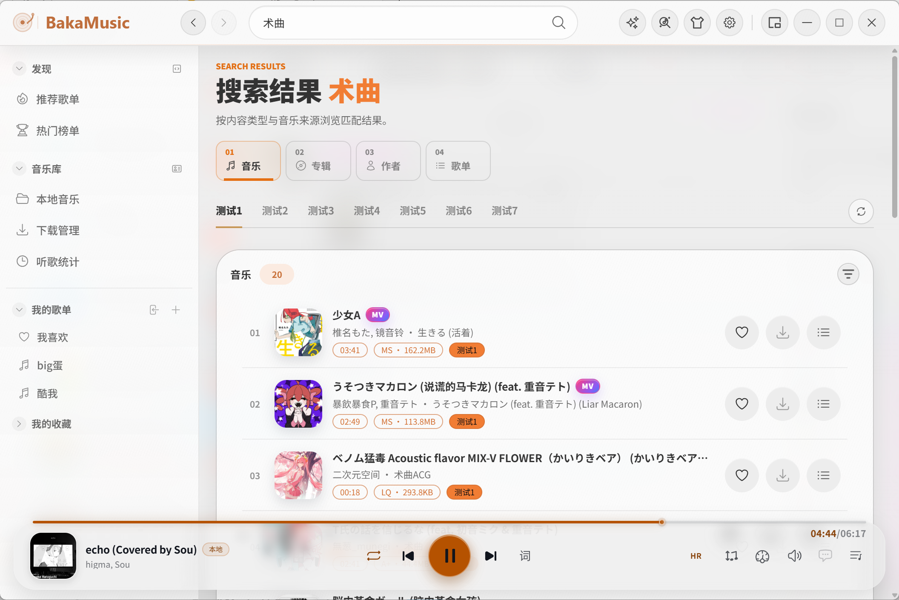 | 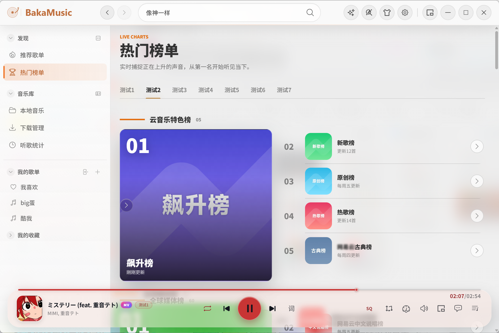 |

| Classic player | AMLL player |
|---|---|
| 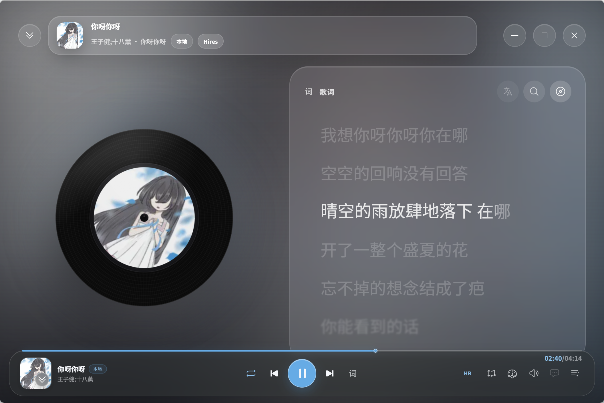 | 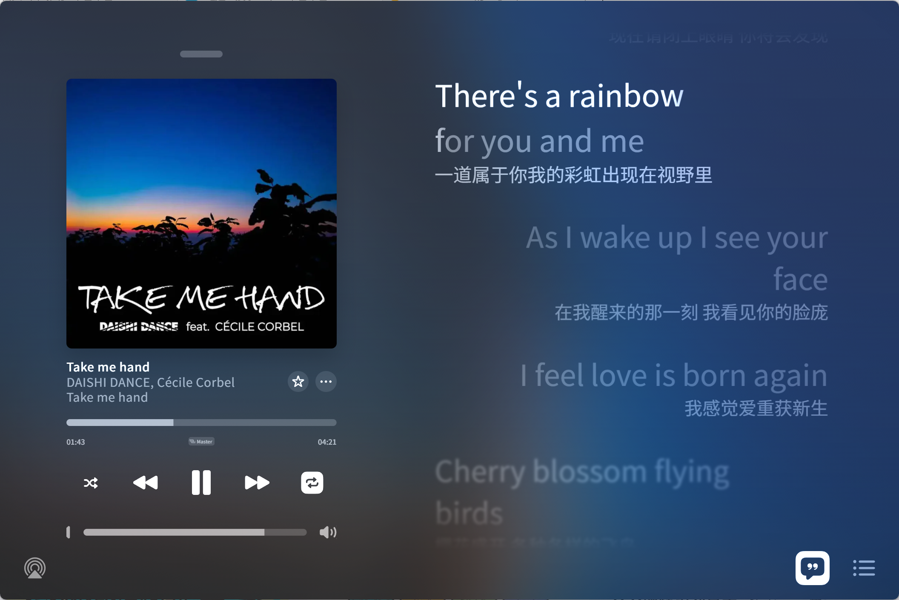 |

| Plugins and LX playback interfaces | Song recognition |
|---|---|
| 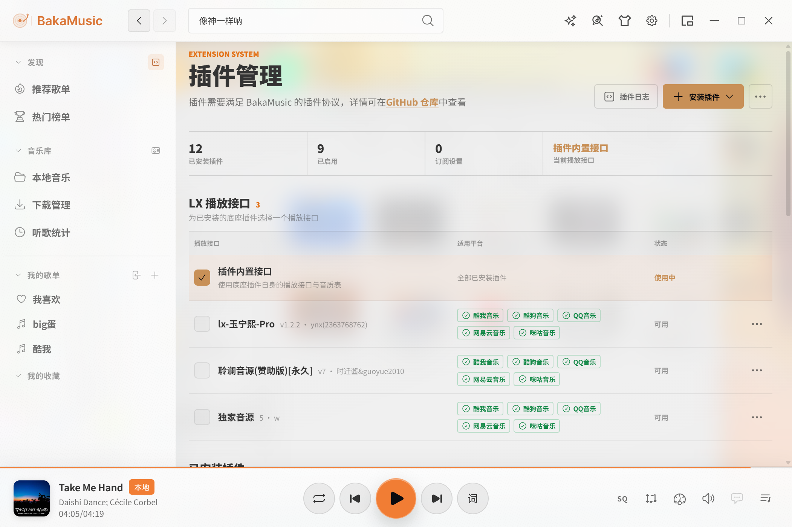 | 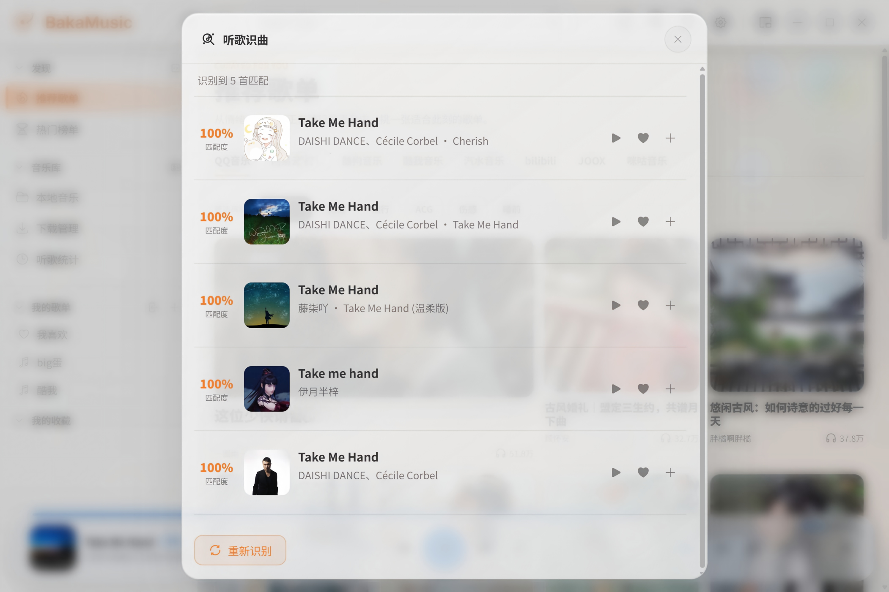 |

| Local music | Downloads |
|---|---|
| 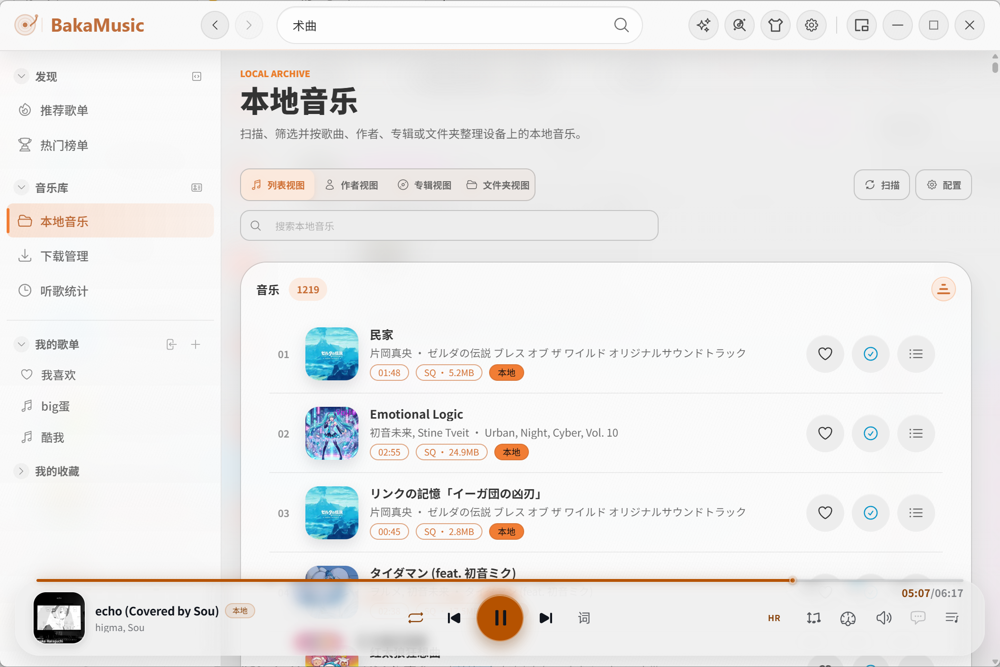 | 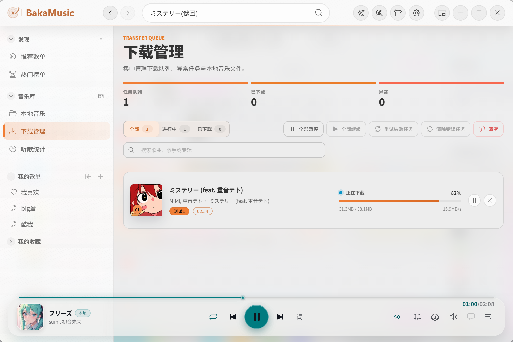 |

| Recommended playlists | Theme marketplace |
|---|---|
| 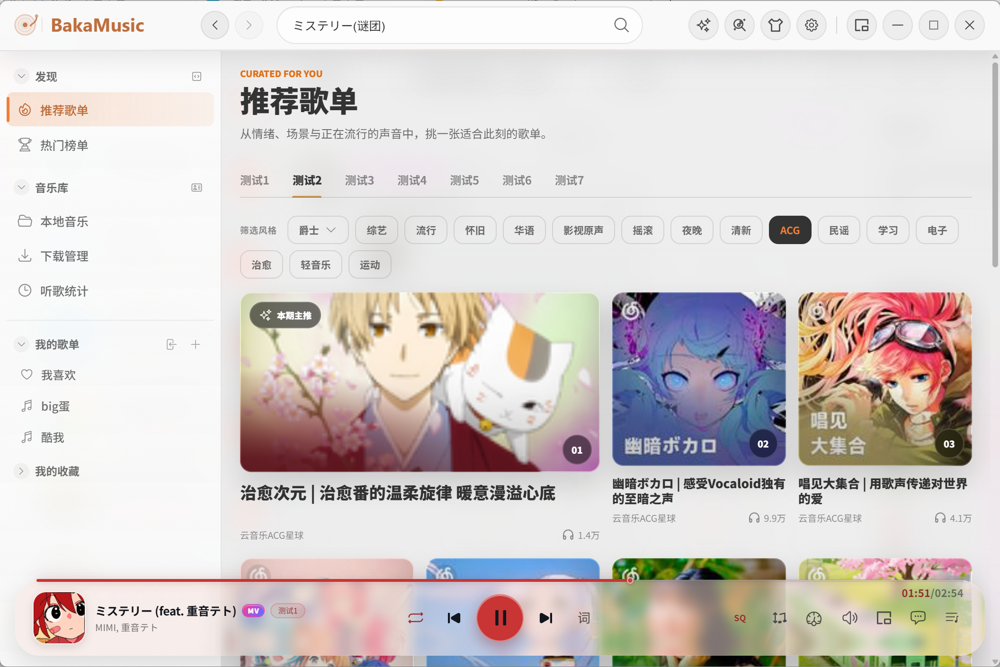 | 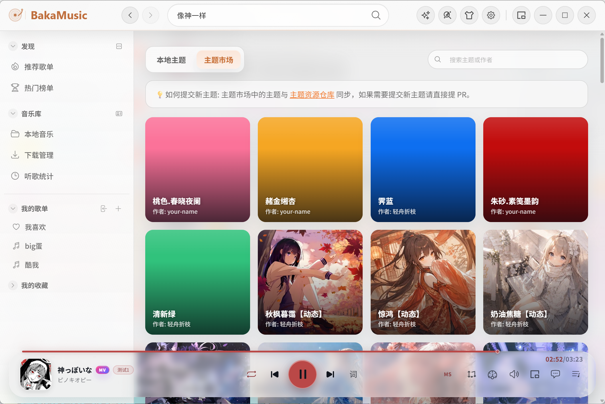 |

| Settings | Dark mode |
|---|---|
| 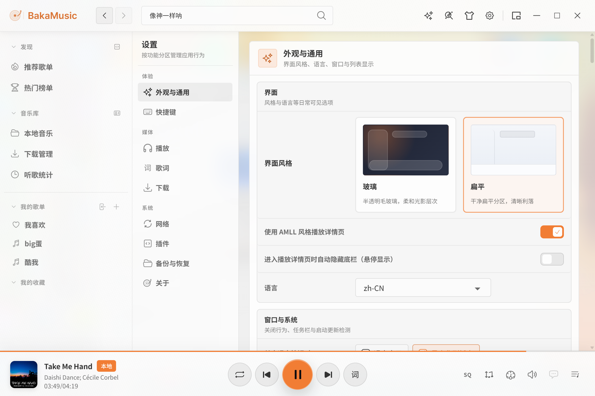 | 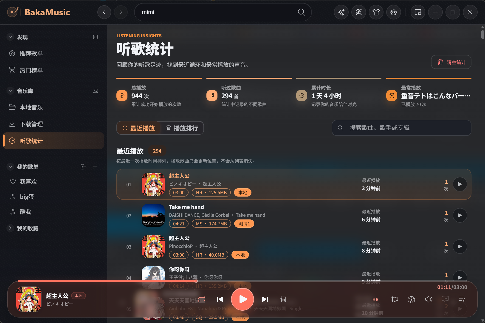 |

<p align="center">
  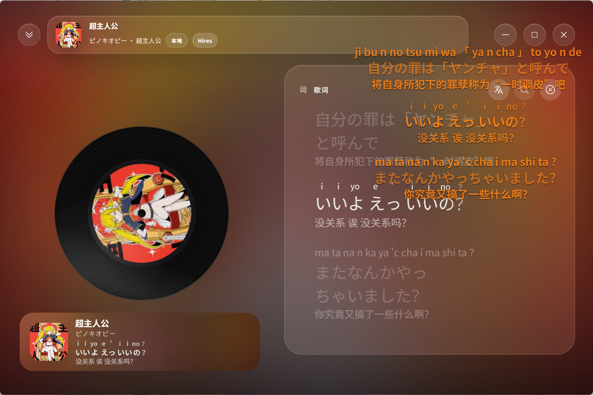
</p>

## Download

Get official builds from [GitHub Releases](https://github.com/Zencok/BakaMusic/releases).

| Platform | Packages |
|---|---|
| Windows x64 | NSIS offline installer / NSIS Web / Portable ZIP |
| macOS x64, arm64 | DMG |
| Linux amd64, arm64 | DEB / AppImage |

Official packages include the libmpv media runtime for their platform. No separate decoder installation is required.

The media runtime is pinned to `runtime-mpv-2a4eb8067c-librempeg-9c00336e26-fb08030026`.
Platform archives and manifests use immutable release URLs and SHA-256 verification.
`npm run runtime:update-manifest` refreshes this pinned release by default; upgrading requires an explicit `--manifest-url`.
When native manifest contents are unchanged, the updater leaves `updatedAt` intact and does not create an empty update PR.

## Plugins and themes

BakaMusic does not bundle online music sources. Plugins run in a separate, managed process, with network, storage and media requests handled through application boundaries.

- Plugin development: [`docs/plugin-development.md`](docs/plugin-development.md) (Chinese)
- Plugin types: [`src/types/plugin.d.ts`](src/types/plugin.d.ts)
- Theme repository: [BakaThemePacks](https://github.com/Toskysun/BakaThemePacks)
- V2 theme contract: [`src/shared/themepack/contract.ts`](src/shared/themepack/contract.ts)

V2 theme packs use the `bakamusic-theme@2` format, with `config.json`, `index.css` and optional `imgs/` and `iframes/` resources. Themes control visuals while the client keeps layout and interactions consistent.

Without a custom theme, the built-in light and dark themes follow your system appearance automatically. Manually selecting a built-in light/dark mode is currently unsupported.

## Development

Requires Node.js `24.19.0` (see `.node-version`) and npm.

```bash
npm install
npm start
```

Before submitting changes, run:

```bash
npm exec tsc -- --noEmit --pretty false
npm exec eslint -- ./src
npm test
```

For window, preload, IPC, service, native or packaging changes, also run:

```bash
npm run package
npm run smoke:package
```

See [`AGENTS.md`](AGENTS.md) for more commands and repository boundaries, and [`changelog.md`](changelog.md) for version history (Chinese).

## Architecture

```text
src/main/               Electron main process and system integration
src/preload/            contextBridge security boundary
src/renderer/           Main-window React application
src/renderer-lrc/       Desktop lyrics window
src/renderer-minimode/  Mini-mode window
src/shared/             Cross-process contracts and shared modules
src/webworkers/         utilityProcess background tasks
src/amll-core/          Complete AMLL upstream synchronization area
res/                    Languages, services and runtime resources
```

Renderers have Node integration disabled and access the main process through minimal preload interfaces. Plugins, downloads, file watching and media services run in isolated processes. Production packages use ASAR and Electron fuses.

## Credits and license

- `src/amll-core/` is based on [applemusic-like-lyrics](https://github.com/amll-dev/applemusic-like-lyrics), with its complete dependency and synchronization boundaries preserved.
- See the [AMLL background implementation notes](./docs/amll-background.md) (Chinese) for local rendering and performance changes.
- The project source is licensed under [AGPL-3.0-only](LICENSE). Third-party code, binary dependencies and theme assets may be subject to their own licenses or authorizations. Retain the relevant copyright notices and comply with their terms when using or distributing them.

## Legal notice and disclaimer

Please read this notice before downloading, installing, using or distributing BakaMusic. It describes the project's scope, lawful-use requirements and risks. Your rights to use, modify and distribute the software are governed by [LICENSE](LICENSE).

### 1. Project scope and third-party content

1. BakaMusic is an open-source desktop music player. **It provides a player, a plugin framework and general local-media management features. It does not bundle online music sources or provide or operate third-party content services.** Playback, downloads and lyric display process content obtained by users through plugins or other means.
2. **Online search results, playlists, lyrics, playback/download URLs and other remote content come from plugins selected and installed by users or third-party services they connect to.** Users import their own local media. Processing playback, caching or downloads at a user's request does not make the project the content provider or grant the user copyright authorization for that content.
3. Third-party extensions include BakaMusic plugins, LX source scripts and other compatible components. Third-party content includes music, music videos, lyrics, covers, images and other potentially protected material. Rights remain with their respective owners.

### 2. Copyright and lawful use

1. Users must comply with applicable laws and regulations, including the Copyright Law of the People's Republic of China where applicable, the source platform's terms of service and rights holders' authorizations. Plugin developers and distributors must ensure that their code, API calls and supplied content have lawful sources and the necessary permissions.
2. Obtain the required permissions before playing, downloading, caching, transcoding, embedding lyrics or sharing content. Access to a URL, public availability, a platform subscription or personal study does not automatically authorize downloading, copying, distributing or commercial use.
3. Do not use this project to infringe copyright, privacy or other lawful rights; unlawfully bypass payment, authentication, access controls or technical protection measures; or distribute unauthorized content or infringing links. Obtain content through rights holders or authorized platforms and support authorized releases.
4. Song titles, artists, covers, lyrics, platform names and trademarks in this README and its screenshots illustrate the interface and features. They belong to their respective owners and do not imply authorization, partnership, certification or endorsement of this project.

### 3. Plugins and external services

1. Users are responsible for obtaining, choosing and installing compliant plugins. Plugin developers and providers are responsible for the legality of their code, data sources, API calls and content authorizations. Users are responsible for how they obtain, use and distribute content. The project does not endorse or guarantee third-party plugins or services, or their legality, accuracy, security or availability.
2. Compatibility with an extension or script format, and the provision of development documentation, describe technical capabilities. They do not imply a partnership, affiliation or authorization from any plugin, source or platform. Check the source, permissions, privacy information and license before installation or use.
3. Third-party extensions and services may send network requests, process user data or read related settings. Be cautious when supplying accounts, cookies, access tokens or other sensitive information. Do not expose these in public issues, logs or screenshots.
4. Third-party APIs, authorization policies, rate limits, fees and availability may change, causing features to fail or stop working. The project does not guarantee continued availability and does not make commitments on behalf of third parties. Each party remains responsible for its own conduct.

### 4. Data and operational risks

1. Local scans, tag/artwork writing, downloads, transcoding, imports, exports and backups may change files or data. Back up important media, playlists, settings and extension data before use, and verify that backups can be restored.
2. WebDAV backups and similar features may upload selected data to a third-party server configured by the user; extensions may also communicate with their own servers. Check what is transferred, the provider's data policies and account security settings. Backup or synchronization features do not guarantee protection against data loss.

### 5. No warranty and limitation of liability

1. To the extent permitted by applicable law, the software is provided "as is" and "as available", without express or implied warranties, including merchantability, fitness for a particular purpose and non-infringement. The authors, contributors and distributors do not guarantee error-free, uninterrupted operation or suitability for every environment or use case.
2. To the extent permitted by applicable law, and subject to sections 15–17 of LICENSE, the authors, contributors and distributors are not liable for damages arising from use of or inability to use the software, including data loss, device or system failure, business interruption, lost profits or other damages, except where required by applicable law or agreed in writing.
3. Disputes arising from third-party plugins, content or services, or from unauthorized acquisition, downloading or distribution of content, are the responsibility of the parties involved under applicable law. To the extent permitted by law, the project's authors, contributors and distributors are not responsible for third-party or user conduct. This notice does not exclude liability that cannot legally be excluded or limited, or excuse any party from responsibility for its own conduct.

### 6. Open-source licensing and redistribution

1. AGPL-3.0-only governs the software and is separate from authorization for third-party content. When using, modifying or distributing this project, comply with LICENSE, including providing corresponding source where required, retaining copyright and license notices, and offering corresponding source to users who interact remotely with a modified version over a network where required.
2. This notice does not add "personal study only" or "no commercial use" restrictions to rights granted by the AGPL. Uses involving third-party music, images, trademarks or other rights still require the appropriate authorization or a legal basis.
3. Modified and redistributed versions should identify their changes and origin, avoiding any misleading suggestion that they are released or endorsed by the project's maintainers. Bundled third-party components and assets must also comply with their own licensing and distribution requirements.

### 7. Rights complaints and interpretation

1. If you believe repository code, release artifacts, documentation or preview images infringe your rights, contact the maintainers through [GitHub Issues](https://github.com/Zencok/BakaMusic/issues). Provide the relevant files or links, evidence of your rights, a description of the issue and a way to contact you. Do not post identity documents, account credentials or other sensitive material publicly; arrange a separate channel if needed.
2. Maintainers will review the supplied information and take appropriate action, such as correction or removal, for matters within the project's control. For third-party plugins, external platforms or remotely supplied content, also contact the relevant provider or rights holder.
3. If this notice conflicts with LICENSE, LICENSE prevails. Mandatory provisions of applicable law prevail over conflicting terms. An invalid provision does not affect the remainder. This notice is not proof of authorization for any third-party content.
