# BakaMusic

[English](README.md) | **简体中文**

[](https://github.com/Zencok/BakaMusic/stargazers)
[](https://github.com/Zencok/BakaMusic/releases/latest)
[](https://github.com/Zencok/BakaMusic/releases)
[](https://github.com/Zencok/BakaMusic/issues)
[](LICENSE)
[](https://t.me/bakaisu)
[](https://t.me/mvscute)

**无广告、无内置在线音源、由插件扩展。**

BakaMusic 是基于 Electron、React 和 TypeScript 的跨平台桌面音乐播放器。应用覆盖在线音乐、本地媒体、MV、逐字歌词、下载与主题定制，并通过插件连接用户选择的内容服务。

> 使用前请阅读[法律声明与免责条款](#法律声明与免责条款)。本项目不内置在线音源；软件开源许可不包含对音乐、歌词、封面等第三方内容的使用授权。请尊重版权、支持正版。

## 功能亮点

- **两套播放详情页**：可在经典沉浸式唱片界面与 AMLL 风格双栏界面间切换，支持动态背景、逐字歌词、全屏和完整播放控制。
- **统一原生播放核心**：音频与 MV 均由 `libmpv + LibreMPEG` 播放，广泛兼容本地音乐与视频格式，并支持远程 HTTP、HLS、自定义请求头和多档画质。
- **杜比与高动态范围**：支持 Dolby Atmos 等空间音频档位、AC-4/AC-3 等环绕声媒体，以及 Dolby Vision、HDR10 MV 的识别与原生渲染链路。
- **全平台 MV**：Windows、macOS 和 Linux 均支持 MV 播放、清晰度切换、倍速、全屏及下载；音频与视频状态可同步到 Windows SMTC、macOS MediaPlayer 和 Linux MPRIS2。
- **双插件生态**：支持功能完整的 BakaMusic 插件，并可导入 LX 音源脚本作为播放接口；插件可扩展搜索、歌单、榜单、歌词、音质、MV、分享和听歌识曲。
- **完整歌词体验**：支持 TTML、LRC、YRC、QRC、ESLRC 等格式，以及逐字、翻译、罗马音、Ruby 注音、背景人声、对唱、桌面歌词和迷你模式。
- **本地库与下载**：提供本地媒体扫描、专辑/艺术家/文件夹浏览、断点续传、批量任务、标签与封面写入、歌词保存和可选下载后转码。
- **个性化与数据管理**：提供玻璃/扁平界面、自动跟随系统的浅色/深色默认主题、V2 主题包、歌单与听歌统计、WebDAV 备份，以及简体中文、繁体中文和 English。

> Dolby Vision、HDR10、Dolby Atmos 等能力取决于媒体源、操作系统、显示/音频设备及其驱动支持。

## 界面

| 主页 | 排行榜 |
|---|---|
| 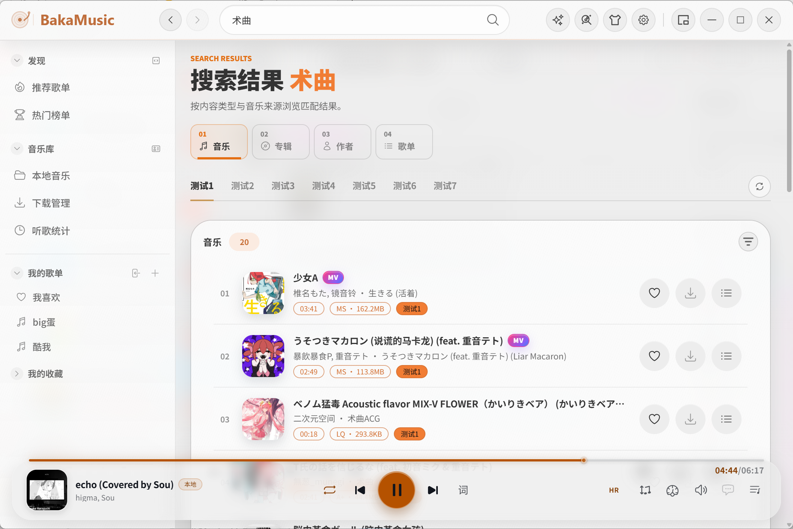 | 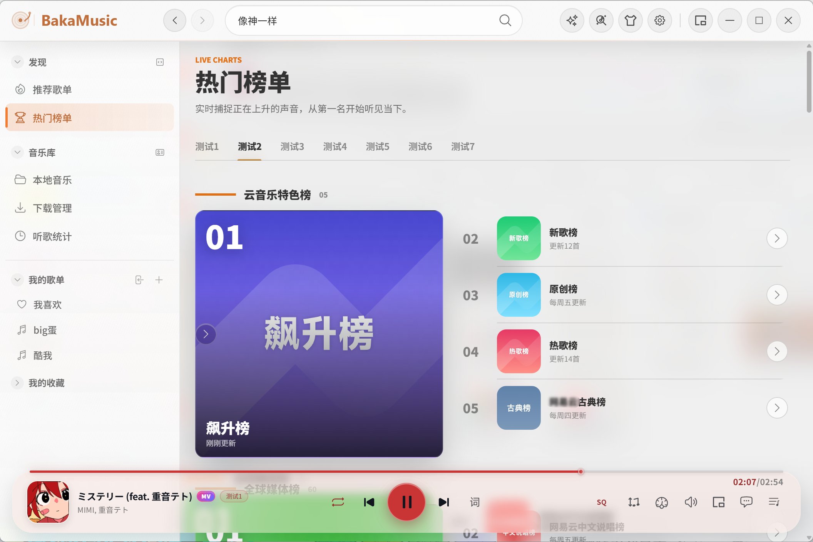 |

| 经典播放详情 | AMLL 播放详情 |
|---|---|
| 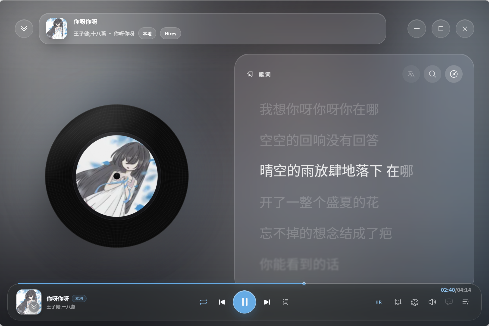 | 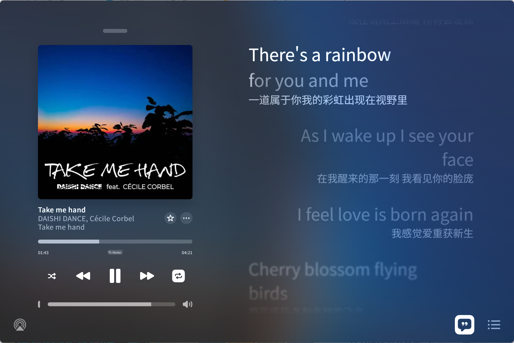 |

| 插件管理与 LX 播放接口 | 听歌识曲 |
|---|---|
| 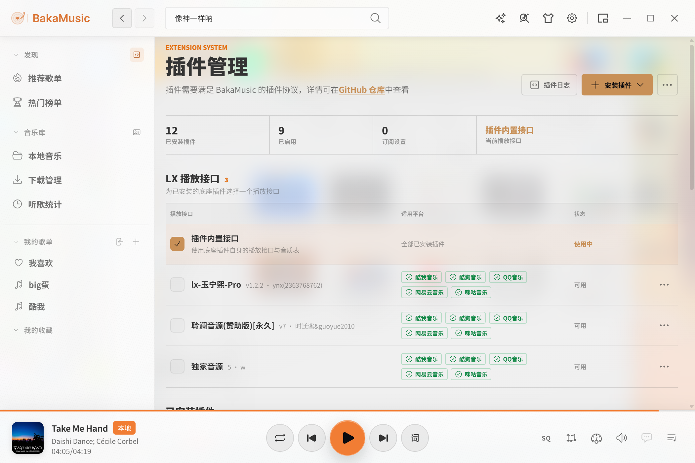 | 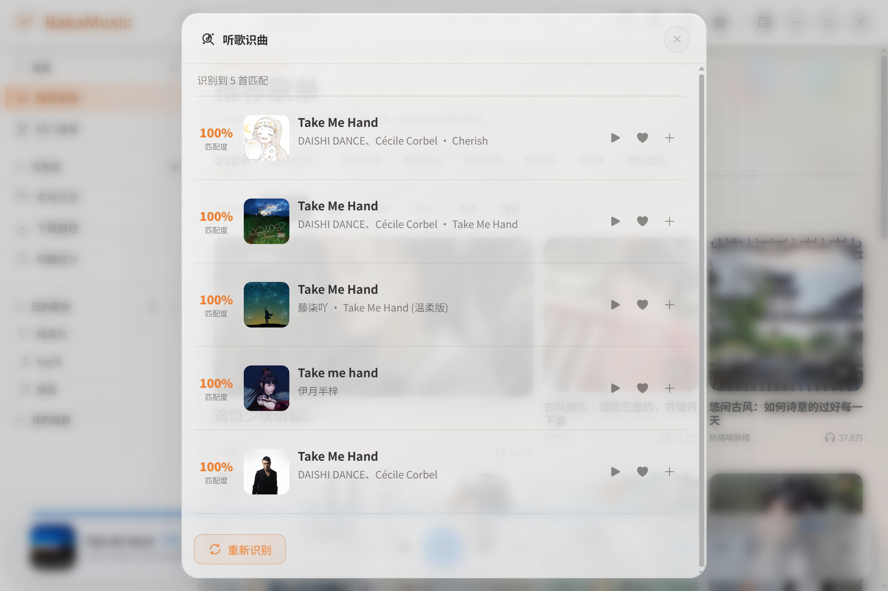 |

| 本地音乐 | 下载管理 |
|---|---|
| 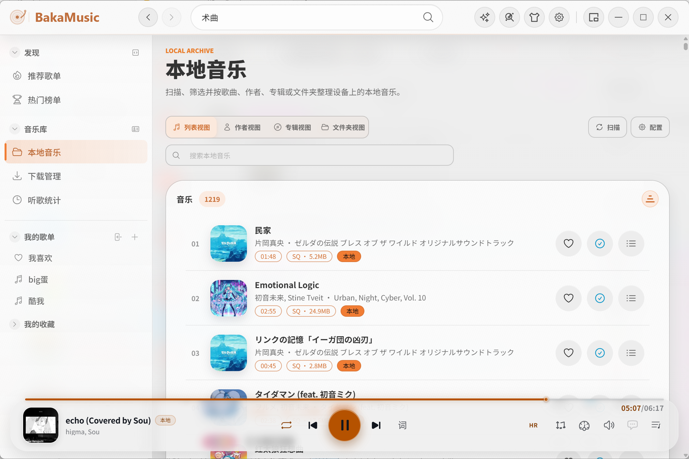 | 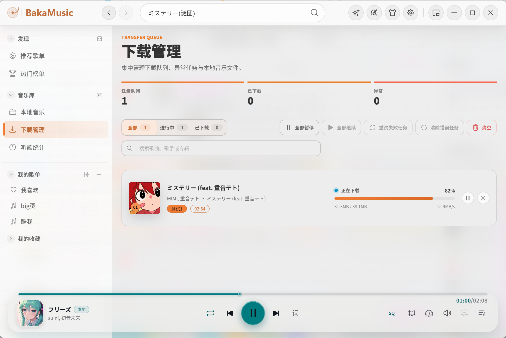 |

| 推荐歌单 | 主题市场 |
|---|---|
| 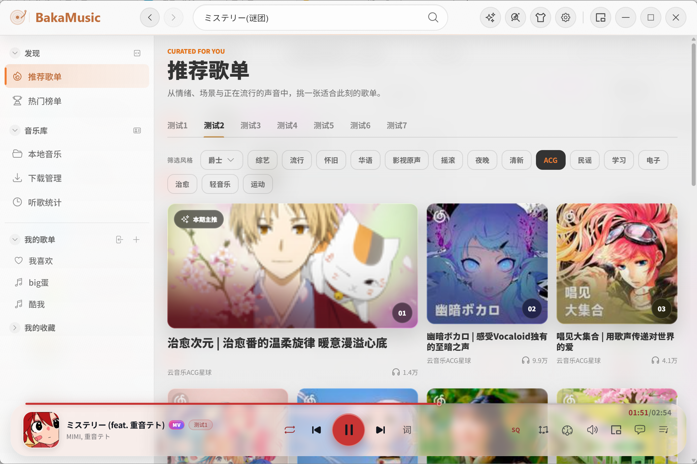 | 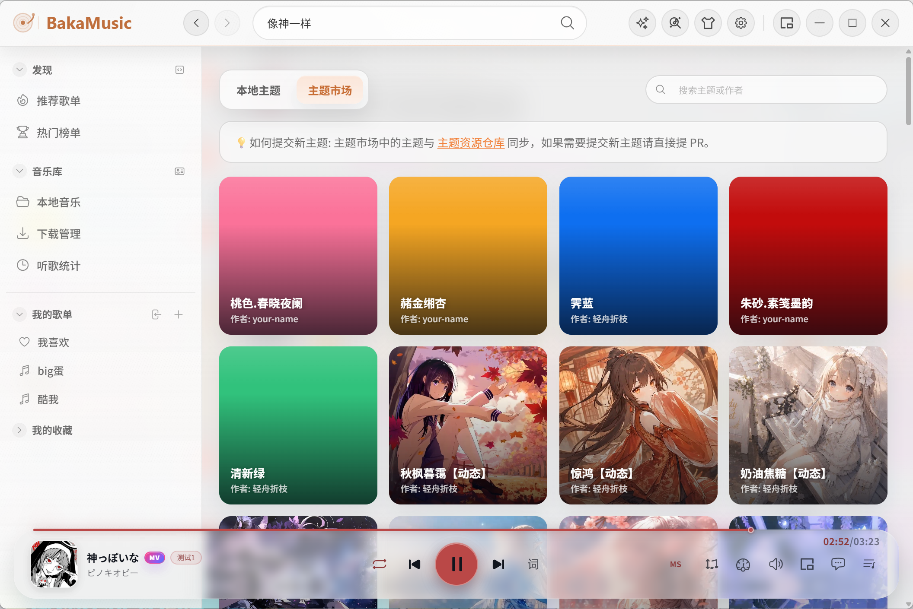 |

| 设置 | 深色界面 |
|---|---|
| 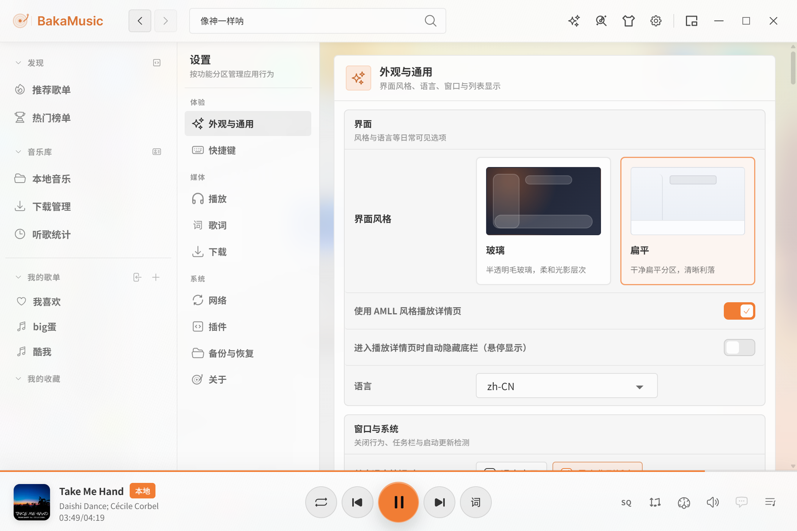 | 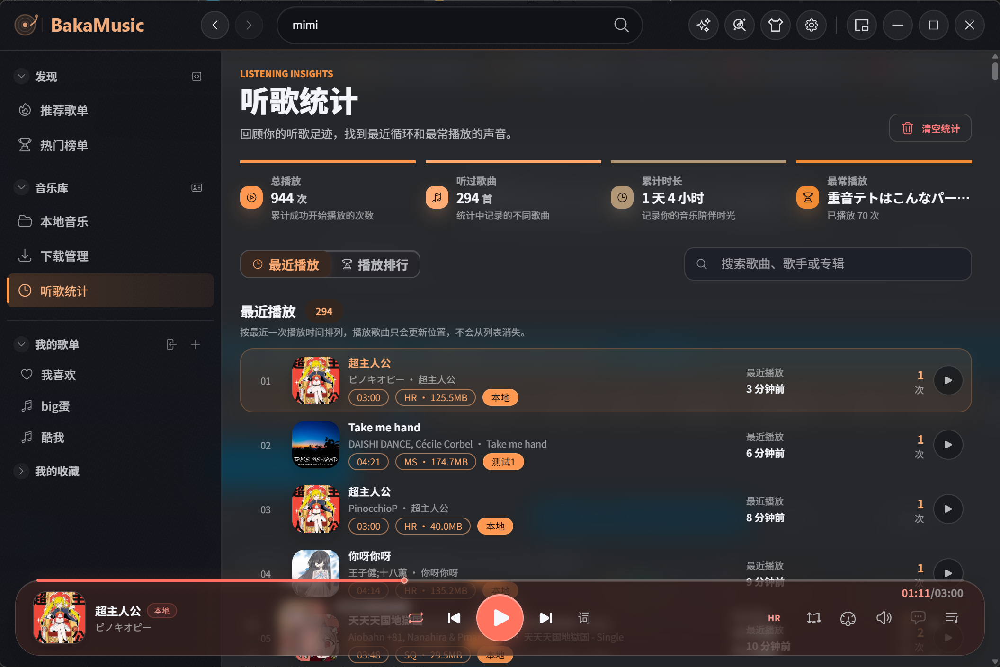 |

<p align="center">
  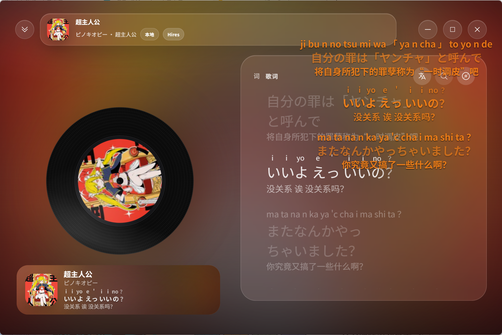
</p>

## 下载

从 [GitHub Releases](https://github.com/Zencok/BakaMusic/releases) 下载正式版本。

| 平台 | 发布包 |
|---|---|
| Windows x64 | NSIS 离线安装包 / NSIS Web / Portable ZIP |
| macOS x64、arm64 | DMG |
| Linux amd64、arm64 | DEB / AppImage |

完整发布包已包含对应平台的 libmpv 媒体运行时，无需单独安装播放组件。

媒体运行时固定使用 `runtime-mpv-2a4eb8067c-librempeg-9c00336e26-fb08030026`，
五平台归档及清单均以不可变发布 URL 和 SHA-256 锁定。
`npm run runtime:update-manifest` 默认仅刷新这个固定发布；升级需显式指定
`--manifest-url`。Native 清单内容未变化时，不刷新 `updatedAt` 或生成空更新 PR。

## 插件与主题

BakaMusic 不附带在线音源。插件在独立受控进程中运行，网络、存储和媒体能力由应用边界统一管理。

- 插件开发：[`docs/plugin-development.md`](docs/plugin-development.md)
- 插件类型契约：[`src/types/plugin.d.ts`](src/types/plugin.d.ts)
- 主题包仓库：[BakaThemePacks](https://github.com/Toskysun/BakaThemePacks)
- V2 主题契约：[`src/shared/themepack/contract.ts`](src/shared/themepack/contract.ts)

V2 主题包使用 `bakamusic-theme@2` 规范，由 `config.json`、`index.css` 及可选的 `imgs/`、`iframes/` 资源组成。主题负责视觉，布局和交互由客户端保持一致。

未安装自定义主题时，内置默认主题会在浅色和深色两套配色间自动跟随系统设置切换，目前不支持手动选择默认主题的明暗模式。

## 本地开发

要求 Node.js `24.19.0`（见 `.node-version`）及 npm。

```bash
npm install
npm start
```

提交前运行：

```bash
npm exec tsc -- --noEmit --pretty false
npm exec eslint -- ./src
npm test
```

涉及窗口、preload、IPC、服务、native 或打包的变更还需运行：

```bash
npm run package
npm run smoke:package
```

更多脚本与仓库边界见 [`AGENTS.md`](AGENTS.md)，版本变化见 [`changelog.md`](changelog.md)。

## 架构

```text
src/main/               Electron 主进程与系统能力
src/preload/            contextBridge 安全边界
src/renderer/           主窗口 React 应用
src/renderer-lrc/       桌面歌词窗口
src/renderer-minimode/  迷你模式窗口
src/shared/             跨进程契约与能力模块
src/webworkers/         utilityProcess 后台任务
src/amll-core/          AMLL 上游同步区
res/                    语言、服务与运行时资源
```

Renderer 默认关闭 Node integration，并通过最小化 preload 接口调用主进程；插件、下载、文件任务及媒体服务运行在隔离进程中。生产包启用 ASAR 完整性与 Electron fuses。

## 第三方与许可

- `src/amll-core/` 基于 [applemusic-like-lyrics](https://github.com/amll-dev/applemusic-like-lyrics)，并保留完整上游同步边界。
- AMLL 动态背景的本地渲染与调度设计见 [背景实现说明](./docs/amll-background.md)。
- 本项目源代码采用 [AGPL-3.0-only](LICENSE) 许可。第三方代码、组件、字体及其他素材仍受各自适用的许可或授权条件约束，使用与分发时应保留相应版权及许可声明。

## 法律声明与免责条款

请在下载、安装、使用或分发 BakaMusic 前阅读以下说明。本节说明项目的功能边界、内容使用要求与风险；软件的使用、修改和分发权利以 [LICENSE](LICENSE) 为准。

### 一、项目定位与内容来源

1. BakaMusic 是开源桌面音乐播放器，**仅提供播放器、插件运行框架及本地媒体管理等通用功能，不内置在线音源，不自行提供或运营在线音乐内容服务**。播放、下载和歌词展示等功能用于处理用户通过插件接入或自行导入的内容。
2. **在线音乐的搜索结果、歌单、播放与下载地址、歌词及封面等数据，均由用户自行选择和安装的插件及其连接的第三方服务提供**；本地媒体由用户自行导入。播放器按用户操作执行播放、缓存或下载，不代表本项目是相关内容的提供方，也不代表项目或用户已取得相关内容的版权授权。
3. 本文所称第三方扩展包括 BakaMusic 插件、LX 音源脚本和主题包；第三方内容包括音乐、MV、歌词、封面、图片及其他受保护的资料。相关权利归各自权利人所有。

### 二、版权与合法使用

1. 使用者应遵守使用地适用的法律法规（包括适用时的《中华人民共和国著作权法》）、内容来源平台的服务条款及相关授权条件。插件开发者和发布者也应确保其代码、接口调用与所提供内容具有合法来源及必要授权。
2. 播放、下载、缓存、转码、保存歌词、导出或分享内容前，请确认已取得相应权限。能够访问某个地址、内容公开可见、持有平台会员或仅供个人学习，并不当然意味着可以下载、复制、传播或用于商业场景。
3. 不得利用本项目侵犯著作权、隐私或其他合法权益，不得违法绕过付费、身份认证、访问控制或版权保护措施，也不得传播侵权内容或将侵权插件与应用捆绑分发。请通过权利人或获得授权的平台获取正版服务。
4. README 及预览图片中出现的歌曲名称、艺人、封面、歌词、平台名称或商标用于说明界面与功能，其权利仍归相关权利人所有，不表示其对本项目的授权、合作、认证或背书。

### 三、插件、主题与第三方服务

1. 用户应自行获取、选择和安装合规插件；插件开发者与提供者应对其代码、数据来源、接口调用及内容授权的合法性负责，用户应对自身获取、使用和传播内容的行为负责。本项目不为第三方插件及其提供的内容作合法性、准确性、安全性或可用性担保。
2. 支持加载扩展、兼容某种脚本格式或提供开发文档，仅说明技术上的兼容性，不表示本项目与相应插件、音源或平台存在合作、代理或授权关系。请核实来源、权限、隐私说明与服务条款后再安装或使用。
3. 第三方扩展和服务可能发起网络请求、处理用户数据或产生服务费用。请谨慎提供账号、Cookie、访问令牌及其他敏感信息；不要在公开 Issue、日志或截图中暴露这些信息。
4. 第三方接口、授权策略、地域限制、收费规则及服务状态可能变化，相关功能可能失效或终止。本项目不保证第三方服务持续可用，也不代替第三方作出服务承诺。各方应就自身行为依法承担相应责任。

### 四、数据与使用风险

1. 本地扫描、标签与封面写入、下载、转码、导入导出及升级等操作可能改变文件或数据。请提前备份重要媒体、歌单、配置与扩展数据，并自行验证备份是否可恢复。
2. WebDAV 备份等联网功能会根据用户配置向所选服务传输相关数据；第三方扩展也可能向其服务端发送请求。启用前请确认传输内容、服务方的数据处理规则与账号安全设置。备份或同步功能不构成数据绝不丢失的保证。

### 五、无担保与责任限制

1. 在适用法律允许的范围内，本软件按“现状”及“可用状态”提供，作者、贡献者与分发者不作明示或默示担保，包括适销性、特定用途适用性及不侵权担保，也不保证软件无错误、不中断、兼容所有环境或始终满足使用需求。
2. 在适用法律允许的范围内，依照 LICENSE 第 15 至 17 条，作者、贡献者与分发者对使用或无法使用本软件引起的数据丢失、设备或系统故障、业务中断、利润损失及其他损害不承担赔偿责任，但适用法律另有要求或另有书面约定的除外。
3. 因第三方插件、内容服务或用户未经授权获取、下载、传播内容而产生的纠纷，由相关行为主体依法承担责任。在适用法律允许的范围内，项目作者、贡献者与分发者不对这些第三方行为或用户行为承担责任。本声明不排除或限制依法不得排除或限制的责任，也不免除任何一方因自身行为依法应承担的义务。

### 六、开源许可与再分发

1. AGPL-3.0-only 授予的软件权利与第三方内容授权相互独立。使用、修改或分发本项目时，应履行 LICENSE 规定的义务，包括适用时提供对应源代码、保留版权与许可声明，以及就修改后的程序通过网络向交互用户提供对应源代码的获取方式。
2. 本声明不对 AGPL 授予的权利附加“仅限学习”或“禁止商业使用”等限制；涉及音乐、图片、商标等第三方权益的使用，仍需另行满足相应授权及法律要求。
3. 修改版和再分发版本应清晰标明修改与来源，避免使用户误认为其由本项目维护者发布或背书。随附第三方组件与素材也应遵守各自的许可及分发要求。

### 七、权利反馈与条款适用

1. 如认为仓库代码、发布包、文档或预览图片侵犯了您的合法权益，请通过 [GitHub Issues](https://github.com/Zencok/BakaMusic/issues) 联系维护者，提供涉及文件或链接、权利证明、问题描述及可联系的方式。请勿公开提交身份证件、账号凭据等敏感资料；必要时可先请求另行沟通。
2. 维护者将根据所提供的信息核查，并对本项目可控制范围内的问题采取更正、移除或其他适当措施。涉及独立第三方插件、平台服务或其内容的问题，也请同时联系对应提供者或权利人。
3. 本声明与 LICENSE 不一致的，以 LICENSE 为准；与适用法律的强制性规定冲突的，以该规定为准。部分条款无效不影响其他条款依法适用。本声明不构成任何第三方内容的授权证明。
